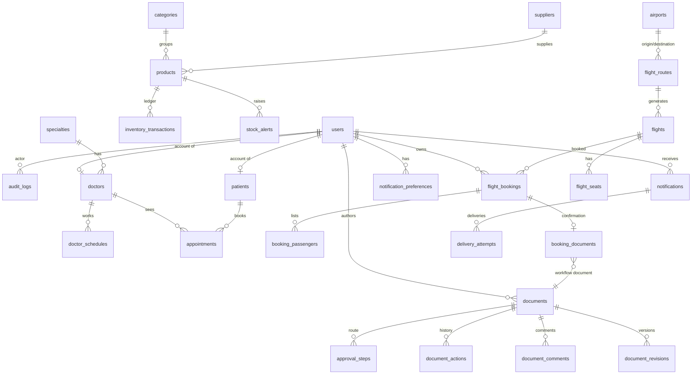

# База данных NEXORA

* СУБД: **MySQL 8.4** (в автотестах — H2 в режиме MySQL с теми же миграциями).
* Схема управляется **только Flyway** (`backend/src/main/resources/db/migration`). Hibernate работает в режиме `ddl-auto: validate` — при несоответствии сущностей и схемы приложение не стартует.
* Время хранится в UTC в `DATETIME(6)` (`hibernate.jdbc.time_zone=UTC`, JVM в UTC). Бизнес-часовой пояс (`Asia/Almaty`) применяется только при расчёте слотов и отображении.
* Деньги — `DECIMAL(12,2)` ↔ `BigDecimal`. Пароли — BCrypt-хеши.

## Миграции

| Версия | Файл | Содержимое |
|---|---|---|
| V1 | `V1__schema.sql` | все таблицы, внешние ключи, индексы, уникальные и CHECK-ограничения |
| V2 | `db/migration/V2__demo_data.java` (Java-миграция, `src/main/java/db/migration`) | демо-данные, согласованные между модулями |
| V3 | `V3__kazakh_localization.java` | перевод демо-данных на казахский (только UPDATE текстовых колонок, идемпотентно) |
| V4 | `V4__kazakh_localization_fixes.java` | дополнительные исправления перевода (коды стратегий и единицы в текстах документов) |

Почему V2 на Java: данные **относительны дате установки** (записи «вокруг сегодня», рейсы на ближайшие дни). Flyway выполняет миграцию один раз (запись в `flyway_schema_history`), поэтому перезапуски данные не дублируют. Плейсхолдеры: `demo_data=false` отключает демо-данные, `demo_flight_days` — горизонт рейсов. Дальше рейсы поддерживает `FlightScheduleService` (при старте и ежедневно, идемпотентно по `UNIQUE(flight_number, departure_time)`).

## ER-диаграмма (основные связи)

## Таблицы

| Таблица | Назначение | Важные ограничения / индексы |
|---|---|---|
| `users` | пользователи, роль (`ADMIN…USER`), BCrypt-хеш | `UNIQUE(username)`, `UNIQUE(email)` |
| `audit_logs` | журнал команд, входов и событий `EVENT_*` | индексы по `created_at`, `(entity_type, entity_id)` |
| `categories`, `suppliers` | справочники склада | уникальные имена |
| `products` | товар: цены, остаток, минимум, стратегия пополнения, `version` | `UNIQUE(sku)`, `CHECK quantity >= 0`, цены ≥ 0 |
| `inventory_transactions` | неизменяемый журнал движений (до/после) | индекс `(product_id, created_at)` |
| `stock_alerts` | предупреждения: OPEN → REQUEST_CREATED → RESOLVED, предложенное кол-во, ссылка на документ | индекс `(status, product_id)` |
| `specialties`, `doctors`, `doctor_schedules` | врачи и недельное расписание | `UNIQUE(doctor_id, day_of_week)`, `CHECK day 1..7` |
| `patients` | вымышленные пациенты, опциональная связь с пользователем | `UNIQUE(user_id)`, индекс по фамилии/имени |
| `appointments` | записи, статус, причина отмены, `version` | `CHECK end > start`, индексы `(doctor_id, start_time)`, `(patient_id, start_time)` |
| `airports`, `flight_routes`, `flights` | аэропорты, шаблоны рейсов, рейсы по дням | `UNIQUE(flight_number, departure_time)`, `CHECK 0 <= available <= total` |
| `flight_seats` | места рейса AVAILABLE/HELD/BOOKED | `UNIQUE(flight_id, seat_number)` |
| `flight_bookings`, `booking_passengers` | брони (State в `status`), пассажиры | `UNIQUE(reference)` |
| `booking_documents` | документ-подтверждение брони | `UNIQUE(booking_id)`, `UNIQUE(document_number)` |
| `documents` | документ: тип, статус (State), сумма, связанный объект, раунд, ревизия, `version` | `UNIQUE(number)` |
| `approval_steps` | шаги согласования по раундам | `UNIQUE(document_id, approval_round, step_order)` |
| `document_actions`, `document_comments`, `document_revisions` | история, комментарии, снимки версий | `UNIQUE(document_id, revision)` |
| `notifications` | входящие пользователя (категория, важность, ссылка, прочитано) | индексы `(recipient_id, created_at)`, `(recipient_id, read_at)` |
| `notification_preferences` | канал вкл/выкл + минимальная важность | `UNIQUE(user_id, channel)` |
| `delivery_attempts` | попытки доставки по каналам (DELIVERED/FAILED/SKIPPED) | индекс по уведомлению |

## Демо-данные (V2)

* 5 пользователей (по одному на роль), настройки уведомлений по умолчанию.
* 6 категорий, 5 вымышленных поставщиков (`... (demo)`), 22 товара; 4 с низким остатком и 1 закончившийся; история движений за 14 дней; открытые предупреждения.
* 6 специализаций, 6 врачей (один связан с аккаунтом `doctor`), расписания, 14 вымышленных пациентов (пометка «Fictional demo patient»), ~100 записей за ±7 дней без пересечений; у `user` есть прошлый и будущий визит.
* 7 аэропортов, 4 вымышленные авиакомпании, 15 маршрутов, рейсы на 14 дней (60 мест каждый), 5 броней (3 подтверждённых, отменённая, истёкшая) с занятыми местами.
* Документы во всех состояниях: заявка на пополнение для реального товара с низким остатком (ожидает менеджера), крупная закупка в IN_REVIEW (ожидает ADMIN), утверждённая закупка, черновик врача, отклонённый медицинский отчёт по реальному завершённому приёму, документ менеджера (ожидает ADMIN), документы-подтверждения для **реальных** подтверждённых броней.
* Уведомления разной важности с попытками доставки и записи аудита.

Сброс демо-данных: `docker compose down -v && docker compose up -d` (удаляет том MySQL).
