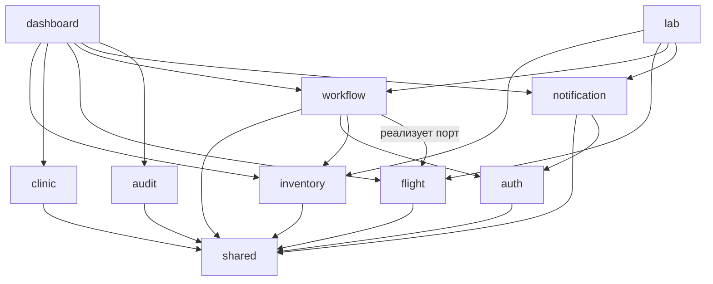
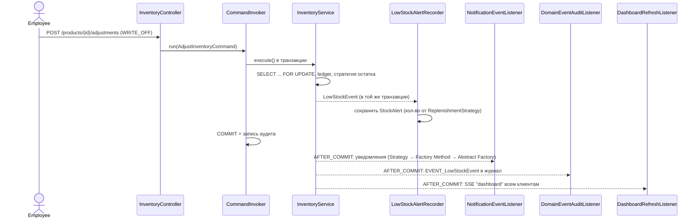
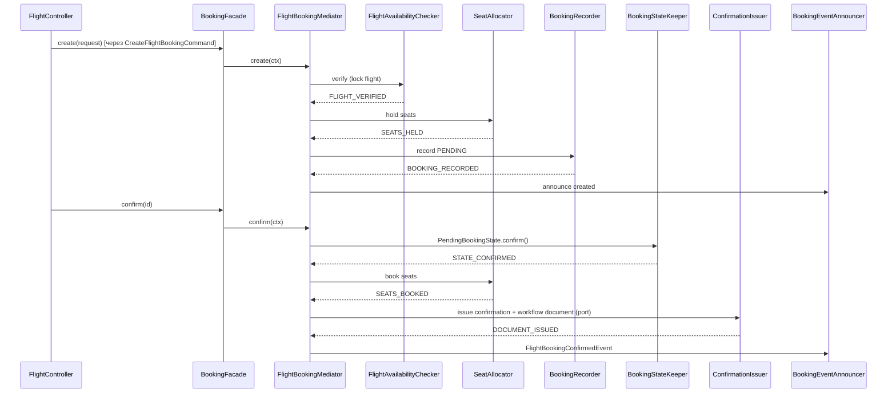
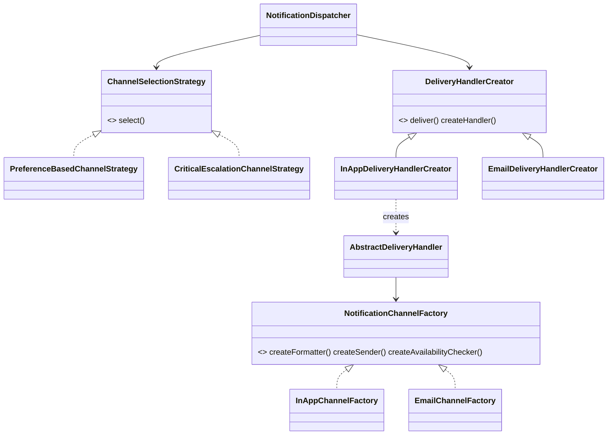

# Архитектура NEXORA

## 1. Общая схема

```mermaid
flowchart LR
    Browser["Браузер<br/>React SPA"] -->|HTTPS/HTTP, cookie + X-XSRF-TOKEN| Nginx
    Browser <-.->|SSE /api/notifications/stream| Nginx
    subgraph Docker Compose
        Nginx["nginx<br/>статика SPA + reverse proxy"] -->|/api, /swagger-ui, /actuator| Backend
        Backend["Spring Boot 3.5<br/>Java 25"] -->|JPA / Flyway| MySQL[("MySQL 8.4")]
    end
    Backend -.->|SMTP (опционально)| SMTP[(SMTP)]
```

В режиме разработки роль nginx выполняет Vite dev-server (`vite.config.ts` проксирует `/api` на `:8080`), поэтому frontend и API всегда на одном origin — cookie-сессия и CSRF работают без CORS.

## 2. Модули backend

```
com.nexora
├── shared        конфигурация, Singleton PlatformSettings, ошибки, события (Observer), Command, безопасность
├── auth          пользователи, вход/выход, управление ролями
├── audit         журнал аудита (реализует AuditTrail), наблюдатель событий
├── inventory     товары, категории, поставщики, движения, предупреждения, стратегии
├── clinic        пациенты, врачи, расписание, записи, PatientAppointmentFacade
├── flight        аэропорты, рейсы, места, брони, State, Strategy, Mediator, BookingFacade
├── workflow      документы, Chain of Responsibility, State, Mediator, Commands, DocumentWorkflowFacade
├── notification  уведомления, Abstract Factory, Factory Method, Strategy, SSE, наблюдатель событий
├── dashboard     агрегаты для главной страницы, наблюдатель для live-обновлений
└── lab           сценарии страницы Design Patterns Lab (вызывают настоящие сервисы)
```

Внутри модулей: `controller` → `facade`/`service` → `repository` → `entity`; `dto` для входа/выхода API (сущности JPA наружу не отдаются), `command`, `state`, `strategy`, `mediator`, `chain` — по необходимости.

### Зависимости между модулями (без циклов)



* Бизнес-модули **не** зависят от notification/audit/dashboard: они только публикуют события из `shared.event`.
* Flight нужен документ-подтверждение, но flight не знает про workflow: он объявляет порт `ConfirmationDocumentPort`, а workflow его реализует (`BookingConfirmationDocumentAdapter`).
* `CommandInvoker` (shared) пишет аудит через порт `AuditTrail`, реализованный модулем audit.

## 3. Межмодульные сценарии (Observer)



## 4. Бронирование рейса: Facade + Mediator + State



## 5. Документооборот: Command + Chain + State + Mediator

```mermaid
flowchart LR
    U[POST /documents/{id}/submit] --> CMD[SubmitDocumentCommand]
    CMD --> INV[CommandInvoker<br/>транзакция + аудит]
    INV --> F[DocumentWorkflowFacade]
    F --> MED[DocumentWorkflowMediator]
    MED --> P[ApprovalRoutePlanner]
    P --> CH{{Chain of Responsibility<br/>Required → Integrity → Permission → Manager → Additional → Routing}}
    MED --> L[DocumentLifecycleKeeper<br/>DraftState.submit]
    MED --> SM[ApprovalStepManager<br/>шаги раунда]
    MED --> H[WorkflowHistoryRecorder]
    MED --> EV[WorkflowEventRelay<br/>DocumentSubmittedEvent]
    EV -.Observer.-> NL[NotificationEventListener]
```

## 6. Уведомления: Strategy + Factory Method + Abstract Factory



## 7. Транзакции и конкуренция

| Риск | Решение |
|---|---|
| Два списания одного товара одновременно | `ProductRepository.lockById` — `PESSIMISTIC_WRITE` (SELECT … FOR UPDATE) + `@Version` |
| Двойная запись к врачу | `DoctorRepository.lockById` сериализует записи одного врача; затем проверка пересечения `[start, end)` для врача **и** пациента (тест на 4 параллельных запроса — успешен ровно один) |
| Последнее место на рейсе | блокировка строки рейса + `UNIQUE(flight_id, seat_number)` + `@Version` на месте и брони |
| Гонка при согласовании | `DocumentRepository.lockById` + `@Version` |
| Ошибка посреди команды | `CommandInvoker` откатывает транзакцию целиком, аудит неудачи пишется в отдельной транзакции |

## 8. Frontend

```
frontend/src
├── lib/          api.ts (клиент, CSRF), types.ts (DTO), format.ts, i18n.ts, roles.ts
├── auth/         AuthContext (сессия, роли)
├── hooks/        useEventStream (SSE), useTab (вкладки в URL), useDebounced
├── components/   ui/* (Button, Card, Modal, Table, Toast...), layout/* (Sidebar, Topbar, поиск, колокольчик), charts/*
└── pages/        dashboard, inventory, clinic, flights, documents, notifications, lab, Audit, Settings, Login
```

* Данные — только через TanStack Query (кеш, инвалидация после мутаций, `keepPreviousData` при пагинации).
* Формы — React Hook Form + Zod; ошибки сервера (`fieldErrors`) отображаются под полями.
* Живые обновления — `EventSource`: `notification` → toast + обновление входящих, `dashboard` → перечитать показатели.
* Страницы модулей подгружаются лениво (`React.lazy`), графики Recharts — отдельный чанк.
